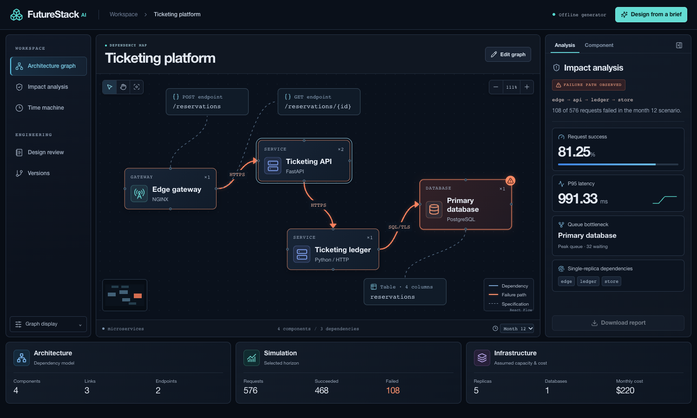

# FutureStack AI
## An Agentic Software Architecture Time Machine

Turn a business brief into a reviewable system design, edit its dependency graph, and compare how two versions behave under the same hypothetical workload. The lab combines structured generation, cited specialist reviews, graph analysis and deterministic discrete-event simulation.



### Try the local demo

Use Python 3.12 and Node 22. Run these commands from the repository root in a POSIX shell. The default generator, evidence index and database run locally.

```sh
python3.12 -m venv .venv
source .venv/bin/activate
python -m pip install -c constraints.txt -e '.[dev]'
npm --prefix web ci
python scripts/start_demo.py
```

Open [the workbench](http://127.0.0.1:3000) and [interactive API documentation](http://127.0.0.1:8000/docs). The launcher starts both processes, forwards the server token when configured, and stops them on Ctrl+C. Set `FS_WEB_PORT` and `FS_API_PORT` in the shell to use different ports. SQLite persists local runs in `futurestack.db`. On a network where the public Yarn registry is the reachable npm-compatible source, use `npm --prefix web ci --registry=https://registry.yarnpkg.com --replace-registry-host=always --strict-ssl=true`.

For the PostgreSQL/pgvector edition, generate local secrets and run Docker Compose.

```sh
python3 scripts/init_env.py
docker compose up --build -d --wait
```

### Reproduce the ticketing experiment

1. Open **Design from a brief**. Generate the default microservices design. Inspect its requirements, original assumptions, three cited findings, and six stage traces.
2. **Approve design** to create version 1. Open **Time machine** and run **Traffic growth** with a base of 24 requests/s over 12 seconds. Select **Month 24**.
3. Choose **Edit graph**. In the inspector select **Primary database**, change replicas from 1 to 3, and save version 2. In **Versions**, compare the current design with version 1 at the same horizon.
4. Switch to **Database failure** to see the component-wide outage propagate along the request path. Download the engineering report for the saved version and selected horizon.

| Simulated result at month 24 | Database ×1 | Database ×3 |
| --- | ---: | ---: |
| Offered requests at 72 requests/s | 864 | 864 |
| Foreground failures | 396 | 0 |
| Successful-request p95 | 991.89 ms | 113.00 ms |
| Assumed monthly infrastructure | $220 | $380 |

The model gives each replica independent processing slots. In a real PostgreSQL deployment, ordinary read replicas cannot scale a write path this way. The experiment isolates a capacity assumption that an engineer can challenge or replace. Production decisions require measured inputs and calibration. The longer demonstration script includes the interpretation. [LinkedIn walkthrough](docs/demo.md)

### What runs

| Capability | Implementation |
| --- | --- |
| Brief to architecture | Pydantic contracts for requirements, gaps, assumptions, component links, dependencies, technology rationale, API contracts and tables. Monolith, microservices and event-driven styles. |
| Review and approval | Six ordered LangGraph stages. Typed provider outputs, two attempts per invocation of a stage, leased execution, durable stage snapshots and human approval before the first immutable version. |
| Editor and time machine | Next.js, TypeScript, Tailwind and React Flow. Add, drag, edit, connect and remove nodes. Edit delivery mode. Compare revisions within or across saved workspaces. |
| Graph and simulation | NetworkX validates dependencies and finds synchronous single-replica dependencies. SimPy models open-loop arrivals, FIFO resources, blocking, finite queues and background work. Five stressors plus baseline, four selectable horizons. |
| Evidence | Curated attributed notes ship with the demo. A CLI ingests and chunks four public reference pages. Normalized feature-hashing embeddings support offline search and PostgreSQL cosine-distance retrieval. Each specialist finding references a retrieved chunk and exact supporting excerpt. |
| Integrations | OCI Generic Chat and a configurable chat-completions-compatible endpoint. OTLP and Langfuse trace export. Two local, read-only MCP tools with typed input and output. |
| Reproducibility | Versioned examples, six evaluation briefs, paired evaluation runner, test suite, browser walkthrough and CI/release workflows. |

### Provider choices

The **demo** generator parses sentences and applies domain templates. It handles ticketing, commerce, telemetry, scheduling and media, with a generic fallback. It records zero model tokens and cost. It can miss requirements, especially novel domain behavior or multiple intents in one sentence. Production-provider runs send the brief and retrieved passages to the chosen model.

For **OCI**, install `python -m pip install -c constraints.txt -e '.[oci,dev]'`, set `FS_PROVIDER=oci`, `FS_MODEL` and `FS_COMPARTMENT`. Use a Generic Chat-compatible on-demand model available in the target region. The default SDK credential chain here loads the named OCI config profile. Instance principal authentication is also available. For a **compatible** service, set `FS_PROVIDER=compatible`, `FS_MODEL_URL`, and `FS_MODEL`. Supply `FS_MODEL_KEY` only when required. Unknown usage or prices appear as unknown. [Configuration and deployment](docs/deployment.md)

### Engineering guide

- [Technical design, architecture diagram and phased roadmap](docs/design.md)
- [Simulator semantics and limitations](docs/simulation.md)
- [REST lifecycle, examples and MCP client setup](docs/api.md)
- [Evaluation methodology and observed results](evaluation/README.md)
- [Deployment, secrets, observability and releases](docs/deployment.md)
- [Local verification record](docs/verification.md)

### Development commands

```sh
python -m pytest -q
python -m evaluation.run --output results.json
npm --prefix web run build
python -m pip install playwright
python -m playwright install chromium
python scripts/smoke_browser.py
```

The browser walkthrough starts temporary services on unused loopback ports and uses a disposable database. Set `FS_CHROME_PATH` to use an installed Chromium-family browser. The PostgreSQL integration test accepts `FS_TEST_POSTGRES` pointing to a dedicated test database. CI provides a fresh pgvector service. After tests and image checks pass, the release workflow publishes API and web images for a version tag.

### Repository

```text
backend/futurestack/     Domain models, graph skills, simulator, review and API
backend/tests/           Unit, integration, provider and tracing contracts
web/                     Next.js workbench and same-origin API proxy
migrations/              Alembic schema history
examples/                Three architectures and six scenario presets
evaluation/              Fixed briefs, paired runner and demo results
scripts/                 Local launcher, environment setup and browser test
docs/                    Technical design, operations, API and demonstration
.github/workflows/       Verification and tagged release delivery
```
