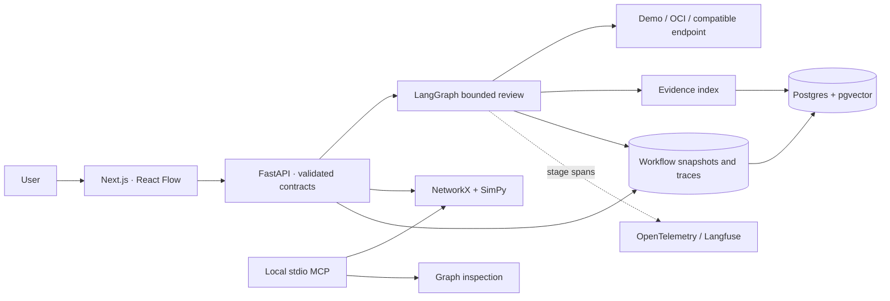
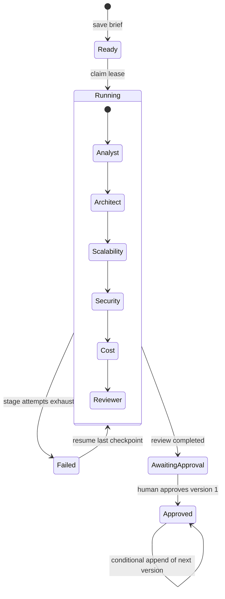

# FutureStack AI · technical design

## User journey

Start with a business brief. Choose a style and inspect a proposed request path, the analyst's assumptions and the evidence behind review findings. Approve a snapshot. Change capacity or dependencies in a new revision. Run the same hypothetical future against either revision and scrub through the results.

## System boundaries

## Contracts and decisions

- A single-workspace service owns briefs, review runs and immutable architecture revisions. A draft becomes a revision only after explicit approval. Optimistic concurrency prevents a stale editor from silently winning. A deployment intended for multiple customers needs tenant ownership, per-user identity, quotas and an authorization review.
- A component has stable identity, kind, technology, rationale, per-replica service time, concurrency, replica count and illustrative monthly cost. Directed edges describe dependency, protocol and synchronous or background delivery. Validate unique IDs, references, single ingress, reachability and acyclicity before a graph enters the simulator. Cyclic workflows require bounded iteration semantics and are outside this model.
- Requirements and architecture are schema-validated provider outputs. The offline provider uses documented rules and templates. Specialist skills derive findings from the graph and indexed source passages. A final reviewer reconciles requirement links and evidence. Run state and completed stages survive process restart. A run has a finite stage budget.
- SimPy owns the event clock. Each component has a FIFO resource pool. Model requests, queuing, outage windows, transit and background work explicitly. Use fixed inputs and deterministic arrival and service schedules to enable paired experiments. Report request counts, tail latency for successful requests, queue pressure, availability and failure paths alongside assumptions. No production SLA or cost prediction is implied.
- The time machine runs independent experiments at named horizons. Compare revisions under identical scenario settings. Advancing a horizon changes the experimental input, without implying a business growth probability.
- Deploy a same-origin web proxy in front of the API. Keep model credentials and workspace access tokens on the server. Bind local demo entry points to loopback. Use a migration job for shared PostgreSQL. SQLite and local vector scoring keep the offline demo lightweight.
- The retrieval corpus has explicit provenance. Offline embeddings use deterministic feature hashing. PostgreSQL ranks the same vectors with pgvector. This baseline favors keyword overlap. An evaluation rubric checks coverage and support without using the generating model as its own judge.
- Expose pure inspection and simulation tools over MCP stdio. Tools take bounded typed models and cannot write versions, run arbitrary commands or contact a provider.

## Repository map

| Directory | Responsibility |
| --- | --- |
| backend/futurestack | Contracts, graph skills, simulation, providers, evidence, workflow, persistence, API, MCP |
| backend/tests | Unit, API lifecycle, persistence and integration tests |
| web | Next.js workbench, topology editor, scenario timeline and comparisons |
| migrations | Versioned relational and vector storage |
| evaluation | Fixed briefs, independent targets and paired evaluation runner |
| examples | Reusable architecture and scenario inputs |
| docs | Architecture, operations, API guide, verification and demo script |
| .github/workflows | Test, build and tagged container release |

## Phased implementation and acceptance

1. **Executable model and editor.** Generate an offline architecture, render/edit a typed graph, run baseline plus traffic growth, database failure and network latency. Test deterministic replay, graph validation and queue/failure behavior. Build the browser client.
2. **Durable review and time machine.** Integrate LangGraph, providers, cited reviews, versioning, restart/resume, comparison, time horizons, service outages, budget constraints, reports and trace inspection. Test approval, conflicts, provenance and paired scenarios.
3. **Portfolio delivery.** Add constrained MCP tools, migration-backed PostgreSQL, instrumentation, evaluation fixtures, container images, CI and deployment guidance. Run the full suite, evaluation, frontend build and available integration smoke checks. Record environmental limits explicitly.

## Deployment trade-offs

A bounded request executes on a server worker. Acknowledged workflow stages are durable. After a crash an in-flight provider call can be repeated and billed again. Separate durable job workers, distributed admission control and hosted identity are follow-on work for a public multi-tenant service. For production calibration, measure distributions and topology on the target system, validate against independent load tests and keep infrastructure pricing separate from assumed unit costs.

## Review and version lifecycle

Each review stage and its usage trace are persisted in the application database. LangGraph controls the ordered execution. The application owns the checkpoint format and the approval transaction so SQLite and PostgreSQL follow the same recovery protocol.
